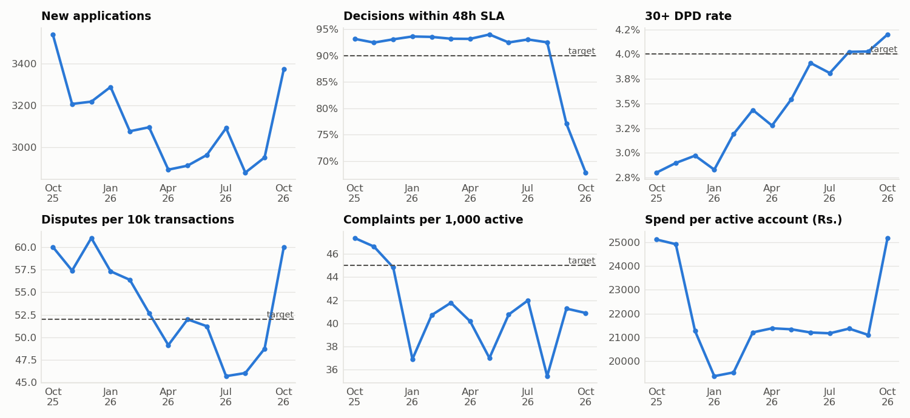

# MIS Report Automation – Card Operations

Builds the monthly card-operations MIS pack in one command. It pulls the source data into SQLite, calculates
16 KPIs in SQL, checks the data before publishing, compares each KPI with last month, last year and its target,
writes the management commentary, and produces an Excel pack with native charts and a one-page PDF.

The commentary drafting and number formatting that used to be done by hand become a reproducible run, and every
run starts with data checks.



## 1. What it produces

| File | Contents |
|---|---|
| `MIS_YYYY_MM.xlsx` | **Scorecard** (this month, prior month, MoM %, same month last year, YoY %, target, Met/Missed, Improving/Worsening), **Commentary**, **Trend** (13-month KPI history, formatted), **Charts** (native Excel charts that update with the data), **Data Checks** |
| `MIS_YYYY_MM.pdf` | One-page summary: commentary, scorecard and trend small multiples |
| `commentary_YYYY_MM.json` | Commentary lines, for e-mail or Teams posting |
| `kpi_history.csv` | All KPIs for all months |

Sample outputs for October 2026 are in [`sample_output/`](sample_output).

## 2. KPIs

| Section | KPIs |
|---|---|
| Acquisition | New applications, approval rate, average decision TAT, % decided within the 48-hour SLA |
| Portfolio | Active accounts, total spend, spend per active account, credit utilisation |
| Credit risk | 30+ DPD rate |
| Servicing | Disputes opened, disputes per 10k transactions, % disputes resolved within 30 days, duplicate-charge share, complaints, complaints per 1,000 active, average complaint resolution days |

Labels, formats, direction (higher or lower is better) and targets are kept in [`mis/kpi_config.py`](mis/kpi_config.py).
The SQL is in [`sql/kpis.sql`](sql/kpis.sql).

## 3. Commentary rules

1. A headline giving how many targeted KPIs met target.
2. Every KPI that missed target, with its value, target and prior month.
3. Every other KPI that moved more than 10% month on month, largest first, tagged favourable or adverse according to the KPI's direction.
4. A driver drill-down: when disputes rise by 10% or more, the dispute reason that grew most is named, with a suggested action.

For October 2026, the run correctly picks out the three events planted in the synthetic data: the onboarding SLA
collapse (67.8% within 48 hours against a 90% target), the dispute spike driven by duplicate charges (151 → 438 cases),
and the slow rise in 30+ DPD past its 4% target.

## 4. Controls on the report itself

The pack is not produced if any of these checks fail:

- Primary keys are unique (applications, disputes, complaints), and there is one account-month row per account per month
- Every month has every KPI populated
- The SQL application count reconciles to the source row count, and SQL total spend to the source total
- No dispute is resolved before it was opened

The results are written to the **Data Checks** sheet, so a reviewer can see they ran.

## 5. How to run

```bash
pip install -r requirements.txt
python -m mis.build                    # latest month
python -m mis.build --month 2026-06    # any month from 2025-10 to 2026-10
python -m pytest -q                    # KPI SQL vs Pandas, reconciliation, Met/Missed direction, commentary
```

## 6. Assumptions

- The source data is **synthetic**: 15,000 accounts, about 40,000 applications, about 10,000 disputes and about 5,500 complaints over 13 months, with planted operational events.
- Targets are illustrative.
- The commentary is a first draft for an analyst to review before circulation. The Excel sheet says so.
